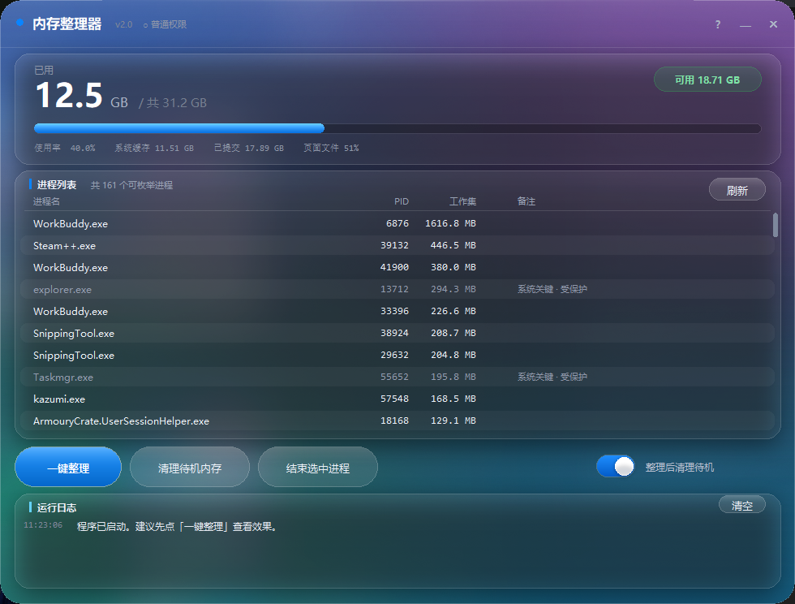

# MemTidy · Windows 内存整理器

[](https://github.com/jiyihao/memtidy/releases/latest)
[](https://github.com/jiyihao/memtidy/blob/main/LICENSE)
[]()
[](https://pypi.org/project/glass-ui/)

**在启动大型游戏 / 工程软件之前，把散落在各个进程里的物理内存集中收回来。**

基于自研的 glass-ui 液态玻璃引擎——界面背后透出的是真实的桌面内容，
不是渐变模拟。单文件免安装，双击就跑。

<div align="center">



</div>

<div align="center">

[](https://github.com/jiyihao/memtidy/releases/latest)

</div>

---

## 功能特性

### 一键深度整理

按固定顺序执行五步，每一步的释放量在运行日志里分步显示：

| 步骤 | 做什么 | 说明 |
|---|---|---|
| 1 | 全进程工作集修剪 | 把每个进程工作集里的物理页移出（带进度条） |
| 2 | 待机列表清理 | 释放系统文件缓存（需管理员；可用数值未必变化） |
| 3 | 已修改脏页写回释放 | 把脏页写回页面文件，变成真正空闲的内存 |
| 4 | 重复物理页合并 | 内核把各进程内容相同的页合并为一份写时复制页（Win10 1607+；Win11 24H2 起系统已移除该接口，自动降级跳过） |
| 5 | 第二轮工作集修剪 | 前面几步之后进程会把页拉回工作集，再快速收割一次 |

### 其它

- **智能提示**：整理完成后自动列出工作集最大的可结束进程（> 150 MB 前 3 名），
  告诉你下一步还能手动释放多少
- **进程列表**：搜索过滤、「可清理优先」排序、滚轮 + 可拖动滚动条
- **安全保护**：系统关键进程（smss / csrss / dwm / 杀软 / 反作弊…）内置保护名单，
  不可结束；列表按「可结束 / 受系统保护 / 名单内」三档标注
- **管理员模式**：启动时可选以管理员身份重启；普通模式下整理流程仍然可用，
  需要管理员的步骤会温和跳过并说明原因
- **玻璃透明度滑块**：0 ~ 100 自由调节界面通透度（出厂 74）。
  100 端是「清玻璃」—— 面纱 0.02、模糊 4px，桌面原样透出来；0 端是浓磨砂
  （面纱 0.78、模糊 30px，等同旧版的 60%）。两端之间线性过渡，模糊半径
  跟着一起走（只降面纱不降模糊，看到的仍然是"雾"而不是玻璃）
- **拖动视差**：按住空白处拖动窗口时，玻璃后的桌面会**相对窗口反向平移**
  （而不是整块跟着窗口走），像真正隔着一层玻璃看桌面。为此引擎做了两级
  缓存，拖动帧从 121 ms 降到 16 ms 左右

---

## glass-ui：技术底座

本仓库是 MemTidy 内存整理器的主页；glass-ui 是它的核心引擎，也作为独立库
发布在 PyPI（仓库改名不影响 PyPI 包名）。

glass-ui 给 tkinter 补上了「看起来像一块真玻璃」需要的一切：抓取窗口后方的
**真实桌面** → 高斯模糊 → 上色调色 → 把卡片/描边/按钮底面合成进同一张底图 →
整张铺成 Canvas 背景，再配一套完全自绘的控件。

[](https://pypi.org/project/glass-ui/)
[](https://pypi.org/project/glass-ui/)
[]()

```bash
pip install glass-ui
```

要求：Windows、Python 3.9+、Pillow 9+。没有 Pillow 时库不会崩，
会自动退化成纯色直角界面。

### 核心模块

| 模块 | 职责 |
|---|---|
| `glass_ui.window` | `GlassWindow` 基类：抓屏时机、拖动视差、背景切片分发、玻璃弹窗 |
| `glass_ui.engine` | `GlassEngine` 渲染管线：模糊、面纱、氛围光、卡片合成；两级缓存（预处理大图 + 静态图层）让拖动帧降到 16 ms |
| `glass_ui.widgets` | 自绘控件：按钮、开关、滑块、表格、日志 |
| `glass_ui.shapes` | 圆角矩形 / 胶囊渐变等图元 |
| `glass_ui.theme` | 配色、字号常量 |
| `glass_ui.win` | Win32 杂项：窗口圆角裁剪、任务栏属性 |
| `glass_ui.compat` | Pillow 可选导入（缺失时优雅降级） |

### 最小示例

```python
import tkinter as tk
from glass_ui import GlassWindow, GlassButton, FONT_UI

class Demo(GlassWindow):
    TITLE = "Hello Glass"
    WIN_W, WIN_H = 720, 420

    def build_ui(self):
        self.make_canvas()                       # 建主 Canvas + 绑定拖动
        self.btn = GlassButton(self, "点我", self.on_click,
                               24, 300, 120, 44, "primary")

    def glass_cards(self):                       # 哪些矩形是卡片
        return [(24, 80, 672, 190)]

    def glass_slices(self):                      # 哪些子控件要背景切片
        return [(self.btn, self.btn.x, self.btn.y, self.btn.w, self.btn.h)]

    def draw_chrome(self):                       # 画字
        cv = self.cv
        cv.delete("all")
        if self.bg_photo is not None:
            cv.create_image(0, 0, image=self.bg_photo, anchor="nw")
        cv.create_text(48, 120, text="你好，玻璃", anchor="w",
                       fill="#ffffff", font=(FONT_UI, 22, "bold"))

    def on_click(self):
        self.info("提示", "模糊的是窗口后面真实的桌面。")

root = tk.Tk()
Demo(root).run()
```

跑起来就有了圆角、无边框、可拖动、背后是真桌面的玻璃窗口。
引擎的渲染管线、调参旋钮（模糊半径 / 面纱 / 透明度换算）以及写库过程中
踩过的 tkinter / Pillow / Win32 的坑，见 [`docs/PITFALLS.md`](https://github.com/jiyihao/memtidy/blob/main/docs/PITFALLS.md)。

---

## 开发者

[`examples/memtidy/`](examples/memtidy/) 就是 MemTidy 本体的完整源码
（单文件 Python + ctypes，可直接打包成 PyInstaller 单文件 exe），
也是学习 glass-ui 用法的最佳参考——界面代码全部调库，本体只剩
Win32 内存接口和「画什么字」。

```bash
git clone https://github.com/jiyihao/memtidy.git
cd memtidy
pip install -e .
python examples/memtidy/memtidy.py          # 直接跑
python examples/memtidy/memtidy.py --selftest   # 功能自检
```

---

## License

[MIT](https://github.com/jiyihao/memtidy/blob/main/LICENSE)
